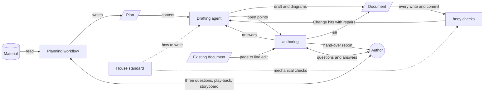

# Authoring: MVP Design

This design describes the authoring skill as a set of elements and the arrows between them. Beside the diagram it lists the files the skill needs, the data each file holds and how the model uses each file, and the requirement of each stage with the reason for the requirement. A requirement the design names is a requirement the build must fulfil. The existing material that can fill each file is recorded in `retention.md` and `source-map.md`.

## The Product

In Ben's words, the product is "an assistant in creating a better process for curation of analysis, and planning of documents, and more consistent application of the team's 'what good looks like'".

The product is one skill, authoring, with a planning workflow inside the skill. Planning reads the material the author points at and agrees a plan with the author in conversation, deciding the content of the document. Drafting goes to a fresh agent that writes only from the plan and applies the team's idea of what good looks like the same way every time. Planning becomes a skill of its own only when something other than authoring needs the planning workflow.

## The System

| Element | Role |
| --- | --- |
| The author | owns every judgement about content, including whether a claim is true: points at the material, answers the planning questions, agrees the plan, answers the drafting questions, reads the result |
| The material | the analysis, decision records and code the author points at, read only by the planning workflow |
| Planning workflow | reads the material, holds the planning conversation and writes the plan |
| The plan | the record of what the document says, and the only source of content the drafting reads |
| Drafting agent | a fresh agent that turns the plan into a document and draws its images, reading only the plan, `writing.md` and the drafting sections of `SKILL.md` |
| authoring | runs the planning workflow, starts the drafting agent, line edits a document that has a plan, and writes short artefacts |
| The house standard | what good looks like: one writing guide with a section for each level of the document, and the mechanical checks as data |
| hedy | the checks a script can make |

### The Files

The files divide by mode, not by level. Guidance read together on every path lives in one file. Guidance for writing and guidance for recognising defects live apart, because the tests for finished prose make a writer defensive when held while drafting. The mechanical checks are data that no model loads. A rule a script can test appears twice by design: `writing.md` states the rule so the model writes to the rule, and `checks.md` holds the test and the repair so hedy enforces the rule. A heading written as a noun phrase is the guidance, and the list of question words a heading must not open on is the test.

| File | Data It Holds | Use by the Model |
| --- | --- | --- |
| `SKILL.md` | the routing between the paths, the stages, the hand-over to the drafting agent and the drafting brief, the reverse outline for both paths, explain and rewrite in its four steps, the question form and its batch rule, the closing-pass checklist with the seam checks, the hand-over report, and the content of a pull request body, a ticket and a commit message | follows it as the procedure from the request to the hand-over, and the drafting agent reads only its drafting sections |
| `planning.md` | the planning conversation: reading the material first, the three opening questions, the play-back with options and previews, the points and questions the editor derives, the four checks, open items, the detail rule and exclusions, the storyboard with an image and a length per section, the written and checked plan, reopening the plan, slide decks, and the limits of the role | reads it when planning a page or deck, before reading the material |
| `writing.md` | the house standard for writing in five sections, each with before-and-after pairs: tone of voice, paragraphs, sentences, document types and forms | reads it in full on every path before writing a word |
| `line-editing.md` | the tests that recognise defects in finished prose, the repair rules, the threshold and stop condition for any change, the exemption for code and quotations, and the author's rights, with before-and-after pairs | reads it only when line editing, after reading the page and its plan |
| `plan-template.md` | the plan in three forms, full, line edit and short artefact, each with its part list in the fixed shape `hedy plan check` parses and its form named on the first line. The full form holds the opening, the governing thought, the detail rule, the exclusions, and per section an image and a length, with questions derived from the points. One worked plan uses every field | writes the plan in the full form at the end of planning, proposes a line-edit plan from the page, and reads every plan against it |
| `checks.md` | every mechanical check, each with its action, Fix or Change, its repair and its allowed forms: the word table, the term list, the punctuation rules, heading title case, and the sentence patterns, such as FAQ voice in a heading, a table header or a sentence opening, a table header ending on a preposition, a sentence ending on `it`, and the contact clause. The term list holds three kinds of row: a replaced name with its preferred name, which is Fix, a term to avoid with its repair, which is Change, and a registered proper noun that passes the word rules | never loads it, because hedy reads it and every hit carries its repair |
| `hedy plan check` | the part list of the form the plan names, for the full and line-edit forms, plus two structural tests: a section with no items, and a question no section answers | runs it before drafting or editing, and stops on any failure |
| `hedy prose check` | the implementation of every check in `checks.md`, run through Vale where Vale can express the check and in hedy where Vale cannot, behaving as "Check Requirements" in `decisions.md` specifies | runs it after writing, resolves each Change hit with the repair the hit carries, and reports the word counts |

### Planning a Document

| Stage | Requirement | Reason | Reads or Runs |
| --- | --- | --- | --- |
| 1. Read the material | the editor knows the material before asking anything | An editor who has read the material can point out what the author's account misses, such as a second reader or a boundary a record draws. Without the material the editor only transcribes. | `planning.md`, the material the author points at |
| 2. Opening questions | the author states the reader, what matters most as a paragraph, and the depth | Writers solve the problems they define for themselves (Flower and Hayes 1981). Asked for one sentence or a short list of points, an author gives a paragraph of several ideas, so the editor distils. | the three questions in `planning.md` |
| 3. Play-back and points | the author agrees the reader, the purpose, the opening and one main sentence, and the points the editor derives | The main sentence is a summary that comes out of the ideas, and each point raises the question the next level answers (Minto). | the question tool, with options and previews |
| 4. Checks | each level holds one category, no gap runs either way, shared terms come first, and each point's consequence if false is known | A grouping of mixed categories, a missing duty or a term used before its definition each broke an earlier page. A point resting on a proposed record misleads unless the author rules on the point. | the four checks in `planning.md` |
| 5. Storyboard | the author agrees each section's heading, point, form, image and length, the detail rule and the exclusions | A storyboard reviewed before prose catches structure faults at the cheapest point (STOP, 1965). A detail rule naming two rungs keeps the page from dead-level abstraction (Hayakawa). | `planning.md`, the heading and form sections of `writing.md` |
| 6. Write the plan | the plan is written beside the material and passes its check, and drafting may reopen the plan | The plan is the only content the drafting receives. Plans change while writing (Flower and Hayes 1981), so a change goes into the plan, never only into the draft. | `plan-template.md`, `hedy plan check` |

### Writing a Document

| Stage | Requirement | Reason | Reads or Runs |
| --- | --- | --- | --- |
| 1. Start | drafting begins only from a complete plan, in which every section has items and every question has a section | A gap in the plan becomes a gap the model fills with invention, and a section with no items is where the model invents most. Writers who outline first write better (Kellogg 1988), and drafting from an outline is the method that works for models too (STORM, Shao et al. 2024). | the plan, `writing.md`, `hedy plan check` |
| 2. Draft each section | each section makes its point from its own items and nothing else, in the form the plan chose, with each paragraph opening on its claim | The reader meets each point first and can stop at any level (Minto). Each document type has conventions its readers expect (Diátaxis). A sentence is easiest to follow with the actor as subject and known information first (Williams, Gopen and Swan). Irrelevant context degrades model output, so a fresh drafting agent holds only the plan, the writing guide and the drafting procedure (Shi et al. 2023, the context-rot study 2025). The agent draws each image the plan describes as a Mermaid diagram. | the drafting agent, `writing.md`, the drafting sections of `SKILL.md`, the mermaid-check skill |
| 3. Check each paragraph | each sentence has a job against the paragraph's point, and no sentence makes the reader reconstruct its meaning | A reverse outline names each sentence's job, so a cut has a stated reason and a condition or a concrete instance survives as a job. A summary-based test drops exactly the conditions and examples the writing guide requires. Turning writer-based shorthand into reader-based prose is Flower's move (1979), which explain and rewrite follows. | the reverse outline and explain and rewrite in `SKILL.md` |
| 4. Questions | nothing the plan leaves open is guessed, and every question reaches the author in one batch | A guess written as fact misleads the reader, and the author cannot see the guess. Editors query the author instead of guessing (Rude and Eaton), and one batch costs the author one sitting. | the question form in `SKILL.md`, the plan's open items |
| 5. Closing pass | the sections read as one document, the seams hold after any removal, and the page answers each of the plan's questions | Sections drafted one at a time repeat each other and lose their joins, and a removal strands pronouns and transitions. The page exists to answer the plan's questions and support its governing thought (Minto). | the closing-pass checklist in `SKILL.md` |
| 6. Mechanical check | no banned form, wrong term, punctuation fault or banned sentence pattern remains, and every heading is in title case | These rules need no judgement to detect, so a script applies them the same way for every author and every AI tool. A Fix rule, such as title case, is applied automatically, and a Change hit, such as a heading in FAQ voice, is reworded by authoring. | `hedy prose check`, the write and turn-end hooks |
| 7. Hand over | the author sees the document, the word count before and after, each renamed heading, the questions still open, and a map by intent when the hand-over names more than one file | The author decides what happens next. Every added word costs the reader, so the author sees the count with every edit, and a renamed heading changes the links into the page. | the hand-over report in `SKILL.md` |

### Line Editing a Document

| Stage | Requirement | Reason | Reads or Runs |
| --- | --- | --- | --- |
| 1. Read | the edit knows the page's purpose, questions and section points from a line-edit plan the author agrees | Without the page's purpose, an edit cannot tell a defect from a choice. Editors agree the level of edit before editing (Van Buren and Buehler 1980, Rude and Eaton). authoring proposes the plan from the page itself and adds no point the page lacks, so the plan records the page without planning new content. | the page, `plan-template.md`, `hedy plan check`, `writing.md` |
| 2. Find defects | each paragraph and sentence defect is found before any change | Experienced editors find a defect at the level the defect sits before changing words (Sommers 1980). | `line-editing.md`, the reverse outline in `SKILL.md` |
| 3. Edit | only paragraphs with a found defect change. The edit improves how each point is said and changes no claim. A dropped sentence that carries a claim goes to the author as a question. The edit stops when a pass finds nothing new | The author owns the content and the choices already made, so only the author cuts a claim. An edit that changes claims is a rewrite, not an edit (Rude and Eaton). A model left without a stop condition rewrites every paragraph. | `line-editing.md`, explain and rewrite in `SKILL.md` |
| 4. Questions | every question reaches the author in one batch | One batch costs the author one sitting (Rude and Eaton). | the question form in `SKILL.md` |
| 5. Closing pass, mechanical check and hand over | as stages 5 to 7 of writing a document, with the mechanical check over the whole page, and each addition listed with its reason | A removal strands joins, and a line edit brings the whole page to the standard. Every addition carries the burden of proof, so the author sees each one with its reason. | as above, with `hedy prose check --all` |

### Writing a Short Artefact

| Stage | Requirement | Reason | Reads or Runs |
| --- | --- | --- | --- |
| 1. Start | the artefact has a purpose and its points | A short text still needs its purpose settled before its words (Kellogg). A file check for a two-line plan costs more than the defect it would catch, so the model asks for a missing purpose or point. | the short-artefact form in `plan-template.md`, `writing.md` |
| 2. Draft | the artefact holds the content of its type | Each artefact's readers expect its content: a reviewer reads a pull request body, a team reads a ticket, which states why, what and constraints and never how, and the history reads a commit message. | the artefact content in `SKILL.md` |
| 3. Check | the same standard as a page | One standard applies to every text the team writes. | `hedy prose check`, run by `create-pr.sh` and the commit-message hook |

## Content, Expression and Mechanics

Each level of a document has one owner:

| Level | The Owner Settles | Owner |
| --- | --- | --- |
| Truth | whether a claim is correct and current | the author |
| Document | the reader, the purpose, meaning what the reader must know or do after reading, the document type, the questions the page must answer, and the governing thought | the plan |
| Section | the order of the sections, the point and form of each, and the questions each answers | the plan |
| Material | the items each section needs, at the level of detail the section needs | the plan |
| Paragraph and sentence | how each point is said, and the joins between sections | authoring |
| Word and pattern | banned forms, punctuation, the team's terms, heading case and the banned sentence patterns | hedy |

Progressive disclosure runs down the same levels. The governing thought states the claim the sections support. Each section's point states the claim its paragraphs support, and each paragraph's first sentence states the claim the rest of the paragraph supports. A reader who stops at any level holds a true picture with less detail. The plan sets the first two levels, and authoring keeps the third in every paragraph.

Three consequences follow for authoring:

1. **authoring writes only from the plan.** A point the plan does not support goes to the author as a question, and is never filled by the model. authoring does not check facts and does not plan.
2. **authoring's edit is a line edit.** A structural edit belongs to planning, and a mechanical edit belongs to hedy. A line edit changes how points are said, never which points are made.
3. **One process serves every size of document.** A pull request body has a plan of a purpose and three points. A design page has a full plan.

## The Read List

The entry point names the guidance for each path:

- **Always read `writing.md`.** It holds the house standard for writing in five sections:
  - **Tone of voice:** a reader can act on the text, and the register is formal, explanatory and deliberate, with no enthusiasm, idiom, humour or chat. Natural prose is preferred over compressed idiom. Claims state facts, mechanisms and consequences, with attribution, absolutes stated with their limits, and dates in place of timebound words, and the comparison carries the judgement. A standard pattern is introduced as plain framing with the system-specific part named. The worst case is written, with each assumption's consequence if the assumption is false. Software runs, people decide, and no reader is addressed as `you`.
  - **Paragraphs:** one job, a first sentence that states the claim the rest supports, the order from claim to mechanism to consequence in an explanatory paragraph, the joins, a rule kept beside its qualification, no restatement of a rule that has a home elsewhere, and the definition of a finished paragraph.
  - **Sentences:** the actor as subject and the action as verb, known information before new, the condition before the action, one claim per sentence, a stable subject, cause words that name the relation, varied sentence length, the requirement words and tense, expansion on first use with one name for one thing, no working codes in reader-facing prose, and capitalisation, numbers, dates and inclusive terms.
  - **Document types:** the person, mode and tense of a how-to, a reference page, an explanation, a decision record and the team's other document shapes. A decision record states requirements, not design. A document is a snapshot, not a changelog. Slides and explainers show the release design.
  - **Forms:** when a list, a table or a diagram serves the reader better than prose, and how the prose beside a table or diagram states consequences and limits rather than repeating the content. Headings are concrete noun phrases, bold lead-ins are preferred to deeper headings, and structure stays in proportion. A page holds at most two links and no pointer sentences, and every link resolves. Diagram notes are numbered under the image. Code takes code font and fences. Text has one line per paragraph outside commit messages.
- **Always read the plan.** It holds its form, the reader, the purpose, the document type, the questions, the governing thought, the sections with their points, forms, questions and material, and the open items with the author's answers.
- **Read `line-editing.md` when line editing an existing page.** It holds the tests that recognise defects in finished prose: compression, framing that carries a judgement, unclear reference, noise, a missing explanation that marks a suspect claim, and an asserted undecided choice, which raises a question. It holds the repair rules: remove whole units, never condense what stays, split a paragraph at the seam, keep every word of a moved condition, give every addition its reason, and turn a guess into a question. It holds the threshold: change only where the reader gains, leave a paragraph with no defect unchanged, and stop when a pass finds nothing new. Code and quotations are exempt. It holds the author's rights: supplied wording is final and cuts stay cut. Headings keep their wording, and the checks still apply.
- **Read `planning.md` when planning a page or deck, before reading the material.** It holds the planning conversation and the limits of the role.
- **Read `plan-template.md` when a plan is written or proposed.**
- **The drafting agent reads only the plan, `writing.md` and the drafting sections of `SKILL.md`.** The material and the planning conversation never reach the drafting.
- **Never load `checks.md`.** Every hit hedy reports carries the repair the model needs.

## The Arrows

| Arrow | Carries | Supported By |
| --- | --- | --- |
| Material to planning workflow | the analysis, decision records and code the author points at | `planning.md` |
| Author and planning workflow | the author's three answers, then the play-back, the checks, the open items and the storyboard for the author to agree | `planning.md`, the question tool with options and previews |
| Planning workflow to plan | the agreed plan, written beside the material and checked | `plan-template.md`, `hedy plan check` |
| Plan to drafting agent | the content of every section, the detail rule, the exclusions, the images and the open items | the drafting brief in `SKILL.md` |
| House standard to drafting agent | how to write, in the tone of voice, the plan's document type and the plan's forms | `writing.md` |
| Drafting agent to document | the draft and its Mermaid diagrams | the drafting brief in `SKILL.md`, the mermaid-check skill |
| Drafting agent to authoring | the open points in the question form, the word count and the check results | the drafting brief's return step in `SKILL.md` |
| Author and authoring | one batch of questions for the open points, and the author's answers, sent on to the named drafting agent | the question form in `SKILL.md`, the plan's open items |
| Existing document to authoring | the page to line edit, with the line-edit plan the author agrees | `line-editing.md`, the line-edit form in `plan-template.md` |
| authoring to document | a line edit as a diff | the line-editing steps in `SKILL.md` |
| Document to hedy | the changed text at every write, turn end, commit, commit message and pull request | `hedy prose check`, the five triggers |
| House standard to hedy | every mechanical check, with its action, repair and allowed forms | `checks.md` |
| hedy to drafting agent | each Change hit: the text, the rule and the repair | `hedy prose check` output, the step for resolving hits in `SKILL.md` |
| authoring to author | the document, the word count, the renamed headings, the open questions, and on a line edit each addition with its reason | the hand-over report in `SKILL.md` |

## The Scripts and Triggers

| Script or Trigger | Input | Output |
| --- | --- | --- |
| `hedy plan check <plan> --json` | a plan in the full or line-edit form | each missing part of the named form, each section with no items, and each question no section answers, which block drafting until the plan is complete |
| `hedy prose check <paths> --json`, with `--fix`, `--all` and `--stdin` | markdown files or text, `checks.md` | the Fix hits applied, each Change hit with its text, rule and repair, only the hits the change introduced unless `--all` asks for every hit on the page, and the word count of each file against its version at HEAD, or zero for a new file |
| The write hook | an agent's write to a file in scope | `hedy prose check` on that file, with the Change hits returned to the agent |
| The turn-end hook | the files in scope that the session changed, in every Claude Code session | `hedy prose check`, blocking the end of the turn while an introduced Change hit remains |
| Pre-commit | the staged markdown | `hedy prose check`, blocking the commit |
| Commit message | the message | `hedy prose check`, blocking the commit |
| `create-pr.sh` | the pull request title and body | `hedy prose check`, refusing the pull request |
| The house-standard rule | an agent reading or writing markdown in scope, with or without the skill | loads by path, names `writing.md`, holds the paths list that sets the scope of the write hook, and carries no drafting digest |

The masking, the exemptions, the `docs` scope and the acceptance tests of `hedy prose check` are specified once, under "Check Requirements" in `decisions.md`. The git hooks reach colleagues in any AI tool, provided `make` has installed hedy and Vale.

## File Locations

| File | Location | Reason |
| --- | --- | --- |
| `SKILL.md` | `.claude/skills/authoring/` | the skill's procedure |
| `line-editing.md`, `planning.md` | `.claude/skills/authoring/references/` | used only by authoring |
| `plan-template.md` | `.claude/skills/authoring/assets/` | the form every plan takes |
| `writing.md`, `checks.md` | `.claude/best-practices/writing/` | the house standard, read by more than one path and cited by hedy |
| The house-standard rule | `.claude/rules/house-standard.md` | loads by path for any agent |
| The two commands | `hedy/src/commands/` | hedy holds all deterministic behaviour |

## Upkeep

A rule in `writing.md`, `line-editing.md` or `checks.md` stays general and never encodes one document set. A rule that serves only one set is a note in that set's plan.

## Changes Outside the Skill

- `pull-requests.md`, `commits.md` and the pr skill point at authoring instead of the editorial skill.
- The jira skill drops its proposed-work section, so the one ticket form states why, what and constraints and never how.

## Later

These wait until a real document shows the need:

- Planning moves into a skill of its own when something other than authoring needs the planning workflow, such as a technical-analyst skill or the decision-record skill.
- A reverse outline for a structural edit: the plan rebuilt from an existing page, recording its claims and judging none of them true or false.
- Marking each source current, superseded or out of scope, and a short quoted span beside each item that hedy checks.
- A plan check for the short-artefact form, when an artefact ships without a purpose.
- Triage of a large body of material, and a term list for each document set.

## Left Out

- Review findings, grades and scores.
- A model acting as a cold reader.
- authoring reading the corpus directly.
- A check that traces each claim in a draft to the plan, which would make authoring check its own claims.
- Fact checking and the synthesis of analysis. Both are separate processes, and neither skill takes on either role.
